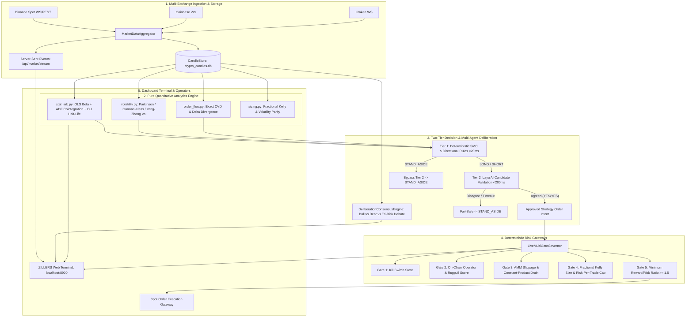

# ZILLERS — Quantitative Architecture, Core Structure & Mathematical Trading Specifications

```
  ███████╗██╗██╗     ██╗     ███████╗██████╗ ███████╗
  ╚══███╔╝██║██║     ██║     ██╔════╝██╔══██╗██╔════╝
    ███╔╝ ██║██║     ██║     █████╗  ██████╔╝███████╗
   ███╔╝  ██║██║     ██║     ██╔══╝  ██╔══██╗╚════██║
  ███████╗██║███████╗███████╗███████╗██║  ██║███████║
  ╚══════╝╚═╝╚══════╝╚══════╝╚══════╝╚═╝  ╚═╝╚══════╝
  Precision Engineered Quantitative Cryptocurrency Execution & Research Terminal
  Engineered by Ekanth B S · Zien Organisation · Version 4.2 Production
```

---

## Table of Contents
1. [Executive Overview & Design Tenets](#1-executive-overview--design-tenets)
2. [Complete Directory & Module Layout](#2-complete-directory--module-layout)
3. [System Architecture & End-to-End Dataflow](#3-system-architecture--end-to-end-dataflow)
4. [Exhaustive Mathematical Trading Formulas](#4-exhaustive-mathematical-trading-formulas)
   - [4.1 Statistical Arbitrage, Cointegration & Ornstein-Uhlenbeck](#41-statistical-arbitrage-cointegration--ornstein-uhlenbeck)
   - [4.2 High-Precision Intra-Bar Volatility Estimators](#42-high-precision-intra-bar-volatility-estimators)
   - [4.3 Microstructure & Order Flow Imbalance (CVD)](#43-microstructure--order-flow-imbalance-cvd)
   - [4.4 Mathematical Capital Allocation & Kelly Criterion](#44-mathematical-capital-allocation--kelly-criterion)
   - [4.5 Smart Money Concepts (SMC) & Multi-Factor Scoring](#45-smart-money-concepts-smc--multi-factor-scoring)
   - [4.6 AMM Constant-Product Slippage & On-Chain Graph Theory](#46-amm-constant-product-slippage--on-chain-graph-theory)
   - [4.7 Time-Machine Empirical Monte Carlo Odds Engine](#47-time-machine-empirical-monte-carlo-odds-engine)
5. [Autonomous Strategy Fleet](#5-autonomous-strategy-fleet)
6. [Multi-Agent Deliberation & Laya Decision Layer](#6-multi-agent-deliberation--laya-decision-layer)
7. [Deterministic Risk Governance & Fail-Closed Protocols](#7-deterministic-risk-governance--fail-closed-protocols)
8. [REST & Streaming API Specifications](#8-rest--streaming-api-specifications)
9. [Verification, Testing & Operations](#9-verification-testing--operations)

---

## 1. Executive Overview & Design Tenets

**ZILLERS** is an institutional-grade quantitative cryptocurrency trading terminal engineered for 24/7 continuous digital asset markets. The system aggregates real-time market data across global spot exchanges (Binance, Coinbase, Kraken), identifies statistical mispricings and volatility compression regimes, evaluates trade candidates through an adversarial multi-agent debate and two-tier decision layer, and governs order execution via deterministic, fail-closed risk gates.

### Core Architectural Tenets
1. **Zero Mock Data in Production (Truth in Data)**: All quantitative indicators, volatility metrics, and order book states compute exclusively over real exchange ticks and stored OHLCV candle databases. When an external feed is unavailable, the system renders transparent unavailable states (`—`) rather than generating synthetic approximations.
2. **Deterministic Risk Dominance**: Mathematical and cryptographic risk bounds override all strategy outputs. Position size limits, stop distances, leverage caps, and emergency kill switches are enforced deterministically before any order can reach an execution gateway.
3. **Fail-Closed Execution**: If any evaluation layer (such as the Laya Tier-2 LLM, an exchange websocket, or an on-chain safety score) times out or errors, the system defaults immediately to `STAND_ASIDE`.
4. **Sub-20ms Deterministic Execution**: Closed-candle quantitative features, order block sweeps, and directional indicators are vectorized using standard Python libraries and NumPy, achieving sub-20ms execution times.
5. **Institutional Dark Ergonomics**: The terminal interface enforces an institutional `#080a0f` dark color scheme, responsive typography (`Inter`, `JetBrains Mono`), real-time SSE streaming, and zero external layout CDNs.

---

## 2. Complete Directory & Module Layout

```
zien-crypto/
├── cryptoscope/                        # Core Python Trading Engine Package
│   ├── quant/                          # Pure Mathematical & Statistical Engine
│   │   ├── __init__.py                 # Public package interface
│   │   ├── stat_arb.py                 # OLS beta, Engle-Granger ADF, Ornstein-Uhlenbeck, Z-Scores
│   │   ├── volatility.py               # Parkinson, Garman-Klass, Yang-Zhang, Compression Regimes
│   │   ├── order_flow.py               # Exact CVD, Delta Divergence, Absorption Detection
│   │   └── sizing.py                   # Fractional Kelly, Volatility Parity, CVaR, Dynamic Sizing
│   │
│   ├── autotrader/                     # Autonomous Trading Decision & Execution Fleet
│   │   ├── __init__.py
│   │   ├── decision.py                 # Fast Two-Tier Decision Layer (Tier 1 Rules + Tier 2 Laya)
│   │   └── strategies/                 # Strategy Implementations
│   │       ├── __init__.py             # Strategy catalog registry
│   │       ├── stat_arb_pairs.py       # Cointegrated Pairs Mean-Reversion Strategy
│   │       ├── volatility_breakout.py  # Volatility Squeeze Breakout Strategy
│   │       ├── volume_breakout.py      # Heavy-Volume Breakout Strategy (放量突破)
│   │       ├── shrink_pullback.py      # Low-Volume Pullback Strategy (缩量回踩)
│   │       └── box_oscillation.py      # Consolidation Box Reversion Strategy (箱体震荡)
│   │
│   ├── agents/                         # Adversarial Multi-Agent Intelligence System
│   │   ├── consensus.py                # DeliberationConsensusEngine (Bull/Bear/Tri-Debate)
│   │   ├── schemas.py                  # Pydantic data schemas (Snapshot, AgentDeliberation)
│   │   ├── analysts/
│   │   │   ├── bull_researcher.py      # Bull Thesis Builder (Catalysts, Structural Demand)
│   │   │   ├── bear_researcher.py      # Bear Thesis Builder (Counter-Trend, Liquidity Traps)
│   │   │   ├── tri_debate.py           # Adversarial Debate Moderator & Risk Balance
│   │   │   └── market.py               # Technical Feature & SMC Indicator Extraction
│   │   └── runners/
│   │       └── ollama_client.py        # Local Ollama LLM Inference Connector
│   │
│   ├── execution/                      # Institutional Risk & Execution Gateways
│   │   ├── governor.py                 # 5-Gate Live Trading Activation & Emergency Kill Switch
│   │   └── order_router.py             # Spot Exchange Order Router (Paper / Live)
│   │
│   ├── risk_tools/                     # On-Chain & Liquidity Risk Governance
│   │   ├── onchain_guard.py            # Union-Find (DSU) Operator Clustering & Token Scoring
│   │   └── amm_impact.py               # Constant-Product (x*y=k) Slippage & Price Impact Models
│   │
│   ├── simulation/                     # Empirical Simulation Engines
│   │   └── time_machine.py             # 2,000-Path Bootstrap Monte Carlo Odds Simulator
│   │
│   ├── market_data/                    # Market Data Feed Infrastructure
│   │   ├── aggregator.py               # Tri-Exchange Composite Ticker & Book Aggregator
│   │   ├── binance_feed.py             # Binance Spot WebSocket / REST Client
│   │   ├── coinbase_feed.py            # Coinbase Advanced Trade WebSocket Client
│   │   ├── kraken_feed.py              # Kraken Spot WebSocket Client
│   │   ├── candle_store.py             # SQLite Real-Time Candle Database (crypto_candles.db)
│   │   └── coingecko.py                # Top 100+ Crypto Listings & Metadata Provider
│   │
│   ├── auth/                           # Security, Session & Cryptographic Store
│   │   ├── store.py                    # SQLite User Credentials & Session Storage (auth.db)
│   │   └── security.py                 # Scrypt (N=2^17) Key Derivation, CSRF, Rate Limiting
│   │
│   ├── fx/                             # Currency Conversion Layer
│   │   └── rate_service.py             # Real-Time USD / INR Live Exchange Rates
│   │
│   ├── dashboard/                      # Web Terminal Server & UI Assets
│   │   ├── __main__.py                 # Threading HTTPServer, REST Endpoints & SSE Stream
│   │   ├── data.py                     # Dashboard Data Aggregation Pipeline
│   │   ├── collaborate_view.py         # Institutional Collaboration Proposals Desk View
│   │   └── static/                     # Terminal Frontend Single-Page Application
│   │       ├── index.html              # Institutional Workspace HTML Shell
│   │       ├── app.js                  # Reactive Terminal State Manager, SSE & Chart Engine
│   │       ├── style.css               # Institutional Dark Design System (#080a0f)
│   │       └── landing/                # Public Venture Landing Page & Pitch Assets
│   │
│   └── tests/                          # Automated Verification Suite (163+ Tests)
│       ├── test_quant_analysis.py      # Statistical Arbitrage, OU, Volatility & Kelly Tests
│       ├── test_server_endpoints.py    # HTTP REST & SSE Endpoints Regression Tests
│       ├── test_live_terminal_e2e.py   # Full End-to-End Live Terminal Integration Suite
│       ├── test_governor.py            # 5-Gate Activation & Emergency Kill-Switch Tests
│       ├── test_onchain_guard.py       # DSU Wallet Clustering & AMM Slippage Tests
│       └── test_simulation.py          # Monte Carlo Odds Engine Accuracy Tests
│
├── work/runtime/                       # Production Runtime Persistence
│   ├── crypto_candles.db               # SQLite Master Candle Database (5m, 15m, 1h, 1d)
│   └── auth.db                         # SQLite Cryptographic Auth & User Session DB
│
├── data/
│   └── collaborations.json             # Operator Collaboration Proposals Storage
│
├── requirements.txt                    # Production Runtime Dependencies
└── pytest.ini                          # Test Framework Configuration
```

---

## 3. System Architecture & End-to-End Dataflow

The platform operates across five asynchronous and deterministic processing tiers:



---

## 4. Exhaustive Mathematical Trading Formulas

Every model implemented in `cryptoscope/` is derived and executed through the following mathematical specifications:

---

### 4.1 Statistical Arbitrage, Cointegration & Ornstein-Uhlenbeck
Implemented in [`cryptoscope/quant/stat_arb.py`](file:///c:/Users/Ekanth's%20laptop/Desktop/my%20projects/zien-crypto/cryptoscope/quant/stat_arb.py).

#### A. Ordinary Least Squares (OLS) Hedge Ratio
For two correlated cryptocurrency price series $P_t^A$ and $P_t^B$, we take the natural logarithms $y_t = \ln(P_t^A)$ and $x_t = \ln(P_t^B)$. The linear relationship is:
$$y_t = \alpha + \beta x_t + \epsilon_t$$

The closed-form OLS estimator for the hedge ratio $\beta$ and intercept $\alpha$ is:
$$\beta = \frac{\sum_{t=1}^N (x_t - \bar{x})(y_t - \bar{y})}{\sum_{t=1}^N (x_t - \bar{x})^2} = \frac{\text{Cov}(x, y)}{\text{Var}(x)}$$
$$\alpha = \bar{y} - \beta \bar{x}$$

#### B. Spread Formulation
The spread series $S_t$ represents the stationary residual deviation:
$$S_t = \ln(P_t^A) - \beta \ln(P_t^B) - \alpha$$

#### C. Engle-Granger Cointegration Test via Augmented Dickey-Fuller (ADF)
To verify that $S_t \sim I(0)$ (stationary) rather than a non-stationary random walk $I(1)$, we estimate the ADF regression:
$$\Delta S_t = \gamma S_{t-1} + \sum_{i=1}^p \psi_i \Delta S_{t-i} + e_t$$

We test the null hypothesis $H_0: \gamma = 0$ (unit root, non-cointegrated) against $H_1: \gamma < 0$ (stationary cointegration). The test statistic is:
$$t_\gamma = \frac{\hat{\gamma}}{\text{SE}(\hat{\gamma})}$$

The test statistic $t_\gamma$ is compared against MacKinnon critical values for a 2-variable system:
- **1% Significance Level**: $t_{\text{crit}} = -3.90$
- **5% Significance Level**: $t_{\text{crit}} = -3.34$
- **10% Significance Level**: $t_{\text{crit}} = -3.04$

When $t_\gamma < -3.34$, the spread is confirmed cointegrated with $\ge 95\%$ confidence.

#### D. Ornstein-Uhlenbeck (OU) Continuous Stochastic Process
The spread is modeled as a continuous mean-reverting OU process:
$$dS_t = \theta (\mu - S_t) dt + \sigma dW_t$$
where:
- $\theta > 0$: Speed of mean reversion.
- $\mu$: Long-term equilibrium spread.
- $\sigma$: Diffusion volatility constant.
- $W_t$: Standard 1D Brownian motion (Wiener process).

In discrete time with sampling interval $\Delta t = 1$, the exact conditional distribution is an AR(1) process:
$$S_t = a + b S_{t-1} + \epsilon_t, \quad \epsilon_t \sim \mathcal{N}(0, \sigma_\epsilon^2)$$

The continuous parameters are recovered through:
$$\theta = -\frac{\ln(b)}{\Delta t}$$
$$\mu = \frac{a}{1 - b}$$
$$\sigma = \sigma_\epsilon \sqrt{\frac{2\theta}{1 - b^2}}$$

#### E. Half-Life of Mean Reversion ($\tau_{1/2}$)
The expected time required for the spread to decay halfway back to its equilibrium mean $\mu$ is:
$$\tau_{1/2} = \frac{\ln(2)}{\theta}$$

If $\tau_{1/2} < 0.5$ bars (excessive noise) or $\tau_{1/2} > 500$ bars (too slow to capitalize on), the pair is discarded as non-viable for statistical arbitrage.

#### F. Dynamic Standardized Z-Score & Strategy Signals
Given a rolling window of length $W$ (default $W = 30$ bars):
$$\mu_{S, W} = \frac{1}{W} \sum_{i=0}^{W-1} S_{t-i}, \quad \sigma_{S, W} = \sqrt{\frac{1}{W-1}\sum_{i=0}^{W-1} (S_{t-i} - \mu_{S, W})^2}$$
$$Z_t = \frac{S_t - \mu_{S, W}}{\sigma_{S, W}}$$

Trading execution thresholds:
- **Long Spread Entry**: $Z_t \le -2.00$ $\longrightarrow$ Long Asset A, Short Asset B ($\beta$ ratio).
- **Short Spread Entry**: $Z_t \ge +2.00$ $\longrightarrow$ Short Asset A, Long Asset B ($\beta$ ratio).
- **Equilibrium Exit**: $|Z_t| \le 0.25$ $\longrightarrow$ Close position for full mean-reversion profit.
- **Structural Break Stop**: $|Z_t| \ge 3.50$ $\longrightarrow$ Immediate flatten to protect against regime breakage.

---

### 4.2 High-Precision Intra-Bar Volatility Estimators
Implemented in [`cryptoscope/quant/volatility.py`](file:///c:/Users/Ekanth's%20laptop/Desktop/my%20projects/zien-crypto/cryptoscope/quant/volatility.py).

#### A. Classical Realized Volatility (Close-to-Close)
$$\sigma_{CC} = \sqrt{\frac{1}{N-1}\sum_{t=1}^N (r_t - \bar{r})^2} \times \sqrt{T}, \quad r_t = \ln\left(\frac{C_t}{C_{t-1}}\right)$$
*Limitation*: Ignores intra-period price paths, high, and low extremes.

#### B. Parkinson Volatility (1980)
Measures the diffusion constant using High ($H_t$) and Low ($L_t$) prices:
$$\sigma_P = \sqrt{\frac{1}{4 \ln(2) \cdot N} \sum_{t=1}^N \left(\ln\frac{H_t}{L_t}\right)^2} \times \sqrt{T}$$
*Efficiency*: Demonstrates approximately $5.2\times$ higher statistical efficiency than close-to-close variance under Brownian price paths.

#### C. Garman-Klass Volatility (1980)
Extends Parkinson by incorporating Open ($O_t$), High ($H_t$), Low ($L_t$), and Close ($C_t$):
$$\sigma_{GK} = \sqrt{\frac{1}{N} \sum_{t=1}^N \left[ 0.5 \left(\ln\frac{H_t}{L_t}\right)^2 - (2\ln 2 - 1)\left(\ln\frac{C_t}{O_t}\right)^2 \right]} \times \sqrt{T}$$
*Efficiency*: Achieves $\sim 7.4\times$ to $8.0\times$ higher precision than close-to-close variance by accounting for intra-candle drift versus range.

#### D. Yang-Zhang Volatility (2000)
A minimum-variance unbiased estimator robust to both continuous drift and overnight price jumps:
$$\sigma_{YZ} = \sqrt{\sigma_o^2 + k \sigma_c^2 + (1 - k)\sigma_{RS}^2} \times \sqrt{T}$$
where:
$$\sigma_o^2 = \frac{1}{N-1}\sum_{t=1}^N \left(\ln\frac{O_t}{C_{t-1}} - \bar{r}_o\right)^2 \quad (\text{overnight jump variance})$$
$$\sigma_c^2 = \frac{1}{N-1}\sum_{t=1}^N \left(\ln\frac{C_t}{O_t} - \bar{r}_c\right)^2 \quad (\text{open-to-close variance})$$
$$\sigma_{RS}^2 = \frac{1}{N}\sum_{t=1}^N \left[\ln\frac{H_t}{O_t}\ln\frac{H_t}{C_t} + \ln\frac{L_t}{O_t}\ln\frac{L_t}{C_t}\right] \quad (\text{Rogers-Satchell variance})$$
$$k = \frac{0.34}{1.34 + \frac{N + 1}{N - 1}}$$

#### E. Volatility Compression Ratio & Regime Classification
Comparing the short-term window Garman-Klass volatility $\sigma_{GK, 20}$ to a longer baseline $\sigma_{GK, 60}$:
$$\text{Compression Ratio (CR)} = \frac{\sigma_{GK, 20}}{\sigma_{GK, 60}}$$

Regimes:
- **`COMPRESSION_SQUEEZE`** ($\text{CR} < 0.65$): Volatility is tightly wound; consolidation floor/ceiling established; explosive breakout is mathematically imminent.
- **`NORMAL_FLOW`** ($0.65 \le \text{CR} \le 1.45$): Order flow is balanced; standard mean-reversion and trend strategies operate normally.
- **`EXPANSION_VOLATILE`** ($\text{CR} > 1.45$): High volatility shock; position sizing scales down to maintain constant risk.

---

### 4.3 Microstructure & Order Flow Imbalance (CVD)
Implemented in [`cryptoscope/quant/order_flow.py`](file:///c:/Users/Ekanth's%20laptop/Desktop/my%20projects/zien-crypto/cryptoscope/quant/order_flow.py).

#### A. Exact Candlestick Volume Delta
Given Binance candlestick attributes with total base volume $V_t$ and taker buy base volume $V_{t, \text{buy}}$:
$$\text{Seller Market Volume } V_{t, \text{sell}} = V_t - V_{t, \text{buy}}$$
$$\Delta V_t = V_{t, \text{buy}} - V_{t, \text{sell}} = 2 V_{t, \text{buy}} - V_t$$

#### B. Cumulative Volume Delta (CVD)
$$\text{CVD}_t = \sum_{i=1}^t \Delta V_i$$

#### C. CVD Linear Trend Slope
The linear regression slope over lookback window $K$ is computed as:
$$\text{Slope}_{\text{CVD}} = \frac{K \sum_{i=1}^K i \cdot \text{CVD}_i - \left(\sum_{i=1}^K i\right)\left(\sum_{i=1}^K \text{CVD}_i\right)}{K \sum_{i=1}^K i^2 - \left(\sum_{i=1}^K i\right)^2}$$

#### D. Institutional Absorption Divergence
- **Bullish Absorption (Accumulation Alert)**:
  $$\text{Price Min}_2 < \text{Price Min}_1 \quad \text{AND} \quad \text{CVD Min}_2 > \text{CVD Min}_1$$
  *Interpretation*: Aggressive market sellers are pushing price down, but CVD forms a higher low because institutional limit orders are absorbing all sell volume. Reversal up expected.
- **Bearish Absorption (Exhaustion Alert)**:
  $$\text{Price Max}_2 > \text{Price Max}_1 \quad \text{AND} \quad \text{CVD Max}_2 < \text{CVD Max}_1$$
  *Interpretation*: Price makes a new high, but CVD fails to make a higher high, indicating market buy orders are being absorbed by institutional limit asks. Reversal down expected.

---

### 4.4 Mathematical Capital Allocation & Kelly Criterion
Implemented in [`cryptoscope/quant/sizing.py`](file:///c:/Users/Ekanth's%20laptop/Desktop/my%20projects/zien-crypto/cryptoscope/quant/sizing.py).

#### A. Discrete Kelly Criterion
Given trade win probability $p$, loss probability $q = 1 - p$, and win/loss payoff ratio $b = \frac{\bar{W}}{\bar{L}}$:
$$\text{Expected Edge } E = (b \cdot p) - q$$

If $E \le 0$, the mathematical expectation is negative or zero:
$$f^* = 0.00 \quad (\text{Fail-Closed Zero Allocation})$$

If $E > 0$, the optimal fraction of bankroll to risk is:
$$f^* = \frac{b \cdot p - q}{b} = p - \frac{1 - p}{b}$$

#### B. Fractional Kelly Allocation
To prevent the high volatility and $50\%+$ drawdowns characteristic of full Kelly under empirical parameter uncertainty:
$$f_{\text{allocated}} = \min(f_{\text{cap}}, \lambda \cdot f^*)$$
where $\lambda$ is selected as:
- $\lambda = 0.25$: **Quarter Kelly** (Institutional risk profile).
- $\lambda = 0.50$: **Half Kelly** (Standard production baseline).
- $f_{\text{cap}} = 0.20$: Hard ceiling of $20\%$ capital risk.

#### C. Volatility Parity (Inverse Volatility Weighting)
When allocating capital across a portfolio basket of $M$ tokens:
$$w_i = \frac{\frac{1}{\sigma_i}}{\sum_{j=1}^M \frac{1}{\sigma_j}}, \quad \sum_{i=1}^M w_i = 1.0$$
$$\text{Capital Allocated}_i = w_i \times \text{Total NAV}$$

#### D. Dynamic Trade Sizing with Volatility Compression Modifier
$$\text{Stop Distance } d = \frac{|P_{\text{entry}} - P_{\text{stop}}|}{P_{\text{entry}}}$$
$$\text{Risk Budget } B_{\text{risk}} = \text{NAV} \times R_{\text{trade}} \times \left(\frac{f_{\text{allocated}}}{0.10}\right) \times M_{\text{vol}}$$
where:
$$M_{\text{vol}} = \begin{cases} 1.15 & \text{if } \text{CR} < 0.65 \text{ (Squeeze expansion bonus)} \\ 0.85 & \text{if } \text{CR} > 1.45 \text{ (High volatility safety dampener)} \\ 1.00 & \text{otherwise} \end{cases}$$

The notional position size in USD is:
$$\text{Position Size USD} = \min\left(0.50 \times \text{NAV}, \frac{B_{\text{risk}}}{\max(d, 0.005)}\right)$$
$$\text{Position Quantity} = \frac{\text{Position Size USD}}{P_{\text{entry}}}$$

#### E. Value-at-Risk (VaR) & Conditional Value-at-Risk (CVaR)
For a distribution of returns $R$ and confidence level $\alpha = 0.95$:
$$\text{VaR}_\alpha = -\text{Percentile}(R, 1 - \alpha)$$
$$\text{CVaR}_\alpha = -\mathbb{E}[R \mid R \le -\text{VaR}_\alpha] = \frac{1}{1-\alpha} \int_0^{1-\alpha} -\text{Quantile}_u(R) du$$

---

### 4.5 Smart Money Concepts (SMC) & Multi-Factor Scoring
Implemented in [`cryptoscope/autotrader/decision.py`](file:///c:/Users/Ekanth's%20laptop/Desktop/my%20projects/zien-crypto/cryptoscope/autotrader/decision.py) and [`cryptoscope/agents/analysts/market.py`](file:///c:/Users/Ekanth's%20laptop/Desktop/my%20projects/zien-crypto/cryptoscope/agents/analysts/market.py).

#### A. Exponential Moving Average (EMA)
$$\text{EMA}_t = \gamma \cdot P_t + (1 - \gamma) \cdot \text{EMA}_{t-1}, \quad \gamma = \frac{2}{K + 1}$$
Computed for $K = 20, 50, 200$.

#### B. Wilder's Relative Strength Index (RSI-14)
$$\Delta U_t = \max(0, C_t - C_{t-1}), \quad \Delta D_t = \max(0, C_{t-1} - C_t)$$
$$\overline{U}_t = \frac{13 \cdot \overline{U}_{t-1} + \Delta U_t}{14}, \quad \overline{D}_t = \frac{13 \cdot \overline{D}_{t-1} + \Delta D_t}{14}$$
$$\text{RS}_t = \frac{\overline{U}_t}{\overline{D}_t}, \quad \text{RSI}_t = 100 - \frac{100}{1 + \text{RS}_t}$$

#### C. Average True Range (ATR-14)
$$\text{TR}_t = \max\left(H_t - L_t, |H_t - C_{t-1}|, |L_t - C_{t-1}|\right)$$
$$\text{ATR}_t = \frac{13 \cdot \text{ATR}_{t-1} + \text{TR}_t}{14}$$

#### D. Fair Value Gaps (FVG)
- **Bullish FVG (Under-priced Liquidity Imbalance)**:
  $$\text{Gap} = L_t - H_{t-2} > 0$$
- **Bearish FVG (Over-priced Liquidity Imbalance)**:
  $$\text{Gap} = L_{t-2} - H_t > 0$$

#### E. SMC Order Block (OB) Validation
- **Bullish Order Block**: The lowest down-close candle prior to an aggressive displacement wave that breaks market structure (BOS) with $\text{Volume} \ge 1.5 \times \overline{V}_{20}$.
- **Bearish Order Block**: The highest up-close candle prior to a downward displacement wave that breaks market structure.

#### F. Composite Directional Score ($-100$ to $+100$)
$$S_{\text{composite}} = w_{\text{trend}} S_{\text{trend}} + w_{\text{mom}} S_{\text{mom}} + w_{\text{fvg}} S_{\text{fvg}} + w_{\text{ob}} S_{\text{ob}}$$
- $\text{Action} = \text{LONG}$ if $S_{\text{composite}} \ge +30$.
- $\text{Action} = \text{SHORT}$ if $S_{\text{composite}} \le -30$.
- $\text{Action} = \text{STAND\_ASIDE}$ if $-30 < S_{\text{composite}} < +30$.

---

### 4.6 AMM Constant-Product Slippage & On-Chain Graph Theory
Implemented in [`cryptoscope/risk_tools/amm_impact.py`](file:///c:/Users/Ekanth's%20laptop/Desktop/my%20projects/zien-crypto/cryptoscope/risk_tools/amm_impact.py) and [`cryptoscope/risk_tools/onchain_guard.py`](file:///c:/Users/Ekanth's%20laptop/Desktop/my%20projects/zien-crypto/cryptoscope/risk_tools/onchain_guard.py).

#### A. Constant-Product AMM Slippage Formula ($x \cdot y = k$)
For a liquidity pool with token reserve $R_{\text{token}}$ and base asset reserve $R_{\text{quote}}$:
$$k = R_{\text{token}} \cdot R_{\text{quote}}$$

When an operator sells $\Delta x$ tokens with trading fee $\gamma = 0.997$ (0.3% fee):
$$\Delta y = \frac{R_{\text{quote}} \cdot \gamma \Delta x}{R_{\text{token}} + \gamma \Delta x}$$

The marginal price before the trade is $P_0 = \frac{R_{\text{quote}}}{R_{\text{token}}}$. The effective execution price is $P_{\text{eff}} = \frac{\Delta y}{\Delta x}$.
The exact price impact percentage is:
$$\text{Price Impact } \% = \left(1 - \frac{P_{\text{eff}}}{P_0}\right) \times 100 = \left(\frac{\gamma \Delta x}{R_{\text{token}} + \gamma \Delta x}\right) \times 100$$

#### B. Disjoint Set Union (DSU / Union-Find) Operator Clustering
To expose Sybil wallet farms and wash-trading rings on-chain, transaction links between wallets are partitioned into equivalence classes using DSU with path compression and union by rank:

$$\text{Find}(x) = \begin{cases} x & \text{if } \text{parent}[x] = x \\ \text{parent}[x] \leftarrow \text{Find}(\text{parent}[x]) & \text{otherwise} \end{cases}$$

$$\text{Union}(x, y) = \begin{cases} 
\text{parent}[r_y] \leftarrow r_x & \text{if rank}[r_x] > \text{rank}[r_y] \\
\text{parent}[r_x] \leftarrow r_y & \text{if rank}[r_x] < \text{rank}[r_y] \\
\text{parent}[r_y] \leftarrow r_x, \, \text{rank}[r_x] \leftarrow \text{rank}[r_x] + 1 & \text{otherwise}
\end{cases}$$

#### C. On-Chain Token Safety Score ($0$ to $100$)
$$\text{Score} = 100 - \sum \text{Penalties}$$
- Top-1 Operator Concentration $> 20\%$: $-35$ pts.
- Virgin Wallet Buyer Ratio $> 40\%$: $-25$ pts.
- Creator graduated $< 1$ previous token: $-20$ pts.
- Liquidity Pool Reserve $< \$50,000$: $-30$ pts.

A token is rejected from trading if $\text{Score} < 65$ (Gate 2).

---

### 4.7 Time-Machine Empirical Monte Carlo Odds Engine
Implemented in [`cryptoscope/simulation/time_machine.py`](file:///c:/Users/Ekanth's%20laptop/Desktop/my%20projects/zien-crypto/cryptoscope/simulation/time_machine.py).

#### A. Empirical Block-Bootstrap Simulation
Instead of assuming a Gaussian distribution, the engine resamples from the empirical vector of historical log-returns $\{r_1, r_2, \dots, r_N\}$ over $M = 2,000$ independent paths over time horizon $H$ bars:
$$P_{t+h}^{(k)} = P_t \cdot \exp\left(\sum_{j=1}^h r_{\tau(j)}^{(k)}\right), \quad k = 1, \dots, M$$

#### B. First-Exit Barrier Probabilities
Let $\tau_{\text{target}}^{(k)} = \inf\{h : P_{t+h}^{(k)} \ge P_{\text{target}}\}$ and $\tau_{\text{stop}}^{(k)} = \inf\{h : P_{t+h}^{(k)} \le P_{\text{stop}}\}$.
The target hit probability is estimated by:
$$\hat{p}_{\text{target}} = \frac{1}{M}\sum_{k=1}^M \mathbb{I}\left(\tau_{\text{target}}^{(k)} < \min(\tau_{\text{stop}}^{(k)}, H)\right)$$
$$\hat{p}_{\text{stop}} = \frac{1}{M}\sum_{k=1}^M \mathbb{I}\left(\tau_{\text{stop}}^{(k)} < \min(\tau_{\text{target}}^{(k)}, H)\right)$$

The trade is permitted only if $\hat{p}_{\text{target}} \ge 50.0\%$ and expected payoff $E[\text{PnL}] > 0$.

---

## 5. Autonomous Strategy Fleet

The autotrader maintains five specialized algorithmic strategies in [`cryptoscope/autotrader/strategies/`](file:///c:/Users/Ekanth's%20laptop/Desktop/my%20projects/zien-crypto/cryptoscope/autotrader/strategies/):

| Strategy Identifier | Class Name | Asset Scope | Primary Signal Driver | Target R:R |
| :--- | :--- | :--- | :--- | :--- |
| `stat_arb_pairs` | `StatArbPairsStrategy` | Cross-Crypto (ETH/BTC, SOL/ETH) | Ornstein-Uhlenbeck Spread Z-Score ($|Z| \ge 2.0\sigma$) | Mean Reversion to Equilibrium |
| `volatility_breakout` | `VolatilityCompressionBreakoutStrategy` | Majors & Altcoins | Garman-Klass Volatility Squeeze ($CR < 0.70$) + CVD Expansion | $2.5 : 1$ |
| `volume_breakout` | `VolumeBreakoutStrategy` | BTCUSDT, SOLUSDT | 20-period swing high violation + $V \ge 1.5\overline{V}_{20}$ | $2.0 : 1$ |
| `shrink_pullback` | `ShrinkPullbackStrategy` | BTCUSDT, ETHUSDT | Low-volume retest of EMA20 in prevailing trend ($V \le 0.75\overline{V}$) | $2.0 : 1$ |
| `box_oscillation` | `BoxOscillationStrategy` | SOLUSDT, XRPUSDT | Mean-reversion bounce off lower/upper 24-bar range boundary | $1.8 : 1$ |

---

## 6. Multi-Agent Deliberation & Laya Decision Layer

To ensure institutional validation before order generation, ZILLERS deploys a two-stage evaluation pipeline:

### 6.1 Fast Two-Tier Decision Layer (`decision.py`)
1. **Tier 1 (Deterministic SMC, $< 20\text{ms}$)**: Evaluates closed candle order blocks, fair value gaps, liquidity sweeps, and composite directional momentum. Generates `LONG`, `SHORT`, or `STAND_ASIDE`.
2. **Tier 2 (Laya AI Candidate Validation, $< 200\text{ms}$)**: If and only if Tier 1 proposes an action, Tier 2 executes two factual, deterministic validation questions:
   - *Q1*: "Given discrete encoding, did price sweep liquidity before this closed candle? Answer YES or NO."
   - *Q2*: "Given discrete encoding, is this an institutional absorption candle? Answer YES or NO."
3. **Consensus Rule**: An order is triggered **only** if Tier 1 and Tier 2 agree (`YES/YES`). If Laya times out ($>200\text{ms}$) or is unavailable, the system safely falls back to `STAND_ASIDE`.

### 6.2 Adversarial Multi-Agent Deliberation (`cryptoscope/agents/`)
- **Bull Researcher**: Evaluates structural demand, order blocks, spot market depth support, and upward momentum.
- **Bear Researcher**: Evaluates counter-trend risk, overhead liquidity traps, and order book resistance.
- **Tri-Debate Moderator**: Weighs opposing theses, applies risk governor limits, and produces a definitive `conviction_score` ($0-100$).

---

## 7. Deterministic Risk Governance & Fail-Closed Protocols

Implemented in [`cryptoscope/execution/governor.py`](file:///c:/Users/Ekanth's%20laptop/Desktop/my%20projects/zien-crypto/cryptoscope/execution/governor.py):

### The 5-Gate Live Trading Activation Protocol
To transition the terminal from `PAPER` mode to `LIVE` order routing, all five gates must pass simultaneously:
1. **Gate 1 — Paper Trade History**: Minimum of $\ge 20$ completed paper trades.
2. **Gate 2 — Profitability Gate**: Positive cumulative net paper PnL ($> \$0.00$).
3. **Gate 3 — Cryptographic Re-Authentication**: Administrator scrypt password verified within the last 300 seconds.
4. **Gate 4 — Explicit Confirmation**: Operator must supply exact confirmation phrase: `"CONFIRM_LIVE_TRADING_BINANCE_SPOT"`.
5. **Gate 5 — Kill Switch Disengaged**: The global emergency kill switch must be clear.

### Master Emergency Kill Switch
- **Action `HALT`**: Immediately ceases all autonomous trade evaluation and cancels pending orders.
- **Action `HALT_FLATTEN`**: Cancels pending orders and dispatches market sell orders to close all open spot inventory into USDT.
- **Resume Requirement**: Requires administrator password verification.

---

## 8. REST & Streaming API Specifications

The terminal server serves both the frontend GUI and machine-to-machine integrations on port `8900`:

| Method | Endpoint | Description | Auth Required |
| :--- | :--- | :--- | :--- |
| `GET` | `/api/market/tickers` | Multi-exchange aggregated ticker prices and spreads | Public |
| `GET` | `/api/market/candles` | Historical and live OHLCV candlestick records | Public |
| `GET` | `/api/market/stream` | Server-Sent Events (SSE) live ticker stream (1 Hz) | Public |
| `GET` | `/api/market/listings` | CoinGecko 100+ active crypto listings with live USD/INR prices | Public |
| `GET` | `/api/quant/pairs` | Stat-Arb Engle-Granger cointegration, OU half-life & Z-scores | Public |
| `GET` | `/api/quant/volatility` | Parkinson, Garman-Klass, Yang-Zhang vol & squeeze regime | Public |
| `GET` | `/api/quant/orderflow` | Cumulative Volume Delta (CVD) & absorption divergence | Public |
| `POST` | `/api/quant/sizing` | Fractional Kelly & Volatility Parity position sizer | Public |
| `POST` | `/api/market/simulate_odds` | 2,000-path empirical Monte Carlo trade odds simulator | Public |
| `POST` | `/api/agents/deliberate` | Adversarial Bull vs Bear deliberation engine | Public |
| `POST` | `/api/risk/token_audit` | DSU wallet clustering & AMM slippage safety audit | Public |
| `GET` | `/api/governor/status` | Live governor mode, kill-switch status, and gate checks | Public |
| `POST` | `/api/governor/kill_switch` | Operator emergency halt / halt-flatten | Session Cookie |
| `POST` | `/api/governor/resume` | Re-enable trading after emergency halt (Admin password) | Admin |
| `POST` | `/api/governor/live_toggle` | 5-Gate live trading activation | Admin |
| `POST` | `/api/auth/login` | Session login with scrypt key derivation ($N=2^{17}$) | Public |

---

## 9. Verification, Testing & Operations

### Test Suite Execution
The codebase enforces rigorous regression testing across all mathematical, networking, and governance layers:

```bash
# Run the complete test suite (163 tests)
pytest cryptoscope/tests -v

# Run pure quantitative math & formula tests
pytest cryptoscope/tests/test_quant_analysis.py -v

# Run server endpoints integration tests
pytest cryptoscope/tests/test_server_endpoints.py -v

# Run end-to-end live terminal tests
pytest cryptoscope/tests/test_live_terminal_e2e.py -v
```

### Launching the Production Terminal Server
```bash
# Start the institutional terminal on localhost port 8900
python -m cryptoscope.dashboard --port 8900
```
Then navigate to `http://localhost:8900` in any modern desktop browser.
Administrator bootstrap: Configure `ADMIN_EMAIL` and a strong `ADMIN_INITIAL_PASSWORD` (minimum 12 characters) in your environment or `.env` file before first launch. The server refuses to start with missing, default, or weak passwords.

---
*Architected and maintained under the Zien Organisation quantitative development guidelines.*
