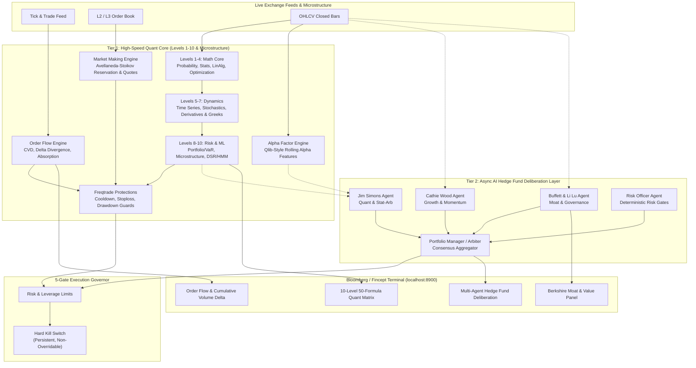

# Institutional Quantitative Engine & Multi-Agent Deliberation Architecture (10 Levels, 50 Formulas + Two-Tier System)

**Date:** 2026-11-11  
**Author:** Antigravity Quant Team  
**Status:** DRAFT (Seeking Approval)  
**References:**
- *"The Entire Quant Theory on One Sheet"* (10 Levels, 50 Formulas by @RitOnChain)
- `https://github.com/microsoft/qlib` (Alpha158 Factor Library)
- `https://github.com/zadescoxp/order-flow-screener` (CVD, Delta Divergence, Absorption)
- `https://github.com/hummingbot/hummingbot` (Avellaneda-Stoikov Pure Market Making)
- `https://github.com/nautechsystems/nautilus_trader` (Bracket Orders & Fill Simulation)
- `https://github.com/freqtrade/freqtrade` (Execution Protections & Cooldown Circuit Breakers)
- `https://github.com/virattt/ai-hedge-fund` & `https://github.com/TauricResearch/TradingAgents` (Multi-Agent Investment Committee)
- `https://github.com/xbtlin/ai-berkshire` (Buffett/Munger/Duan/Li Lu Governance Moat Audit)

---

## 1. System Vision & Architecture

The system combines **Approach 1** (Unified Quantitative & Microstructure Engine) and **Approach 2** (Two-Tier Architecture with Decoupled Async AI Deliberation):

---

## 2. Tier 1: The 10 Levels & 50 Formulas Specification

All 50 formulas are implemented in `core/quant/levels/` with strict numeric stability, zero lookahead enforcement, and pure functions.

### Level 1: Probability (`core/quant/levels/level1_prob.py`)
1. **1.1 Bayes' Rule:** $P(A|B) = \frac{P(B|A)P(A)}{P(B|A)P(A) + P(B|\neg A)P(\neg A)}$. Updates prior signal belief upon receiving market evidence.
2. **1.2 Linearity of Expectation:** $E[\sum X_i] = \sum E[X_i]$. Expectation of multi-asset portfolio payoff across dependent assets.
3. **1.3 Variance:** $\text{Var}(X) = E[X^2] - (E[X])^2$. Measure of dispersion around expectation.
4. **1.4 Total Expectation:** $E[X] = \sum_y E[X|Y=y] P(Y=y)$. Scenario-weighted expected return across regime states.
5. **1.5 Key Distributions:** Probability density & CDF for Gaussian, Student-t (fat tails), Poisson (trade arrival), Exponential, and Uniform.

### Level 2: Statistics (`core/quant/levels/level2_stats.py`)
1. **2.1 Standard Error:** $\text{SE} = \frac{\sigma}{\sqrt{n}}$. Uncertainty band around estimated sample mean.
2. **2.2 Sharpe t-stat:** $t \approx \text{SR} \cdot \sqrt{\text{years}}$. Statistical significance of backtest Sharpe ratio vs null hypothesis ($H_0: \text{SR} = 0$).
3. **2.3 OLS Regression:** $\hat{\beta} = (X^T X)^{-1} X^T y$. Univariate hedge ratio $\beta = \frac{\text{Cov}(x, y)}{\text{Var}(x)}$ and residual variance $\sigma^2_\epsilon$.
4. **2.4 Correlation & $R^2$:** $\rho = \frac{\text{Cov}(X,Y)}{\sigma_X \sigma_Y}$, $R^2 = 1 - \frac{\text{SS}_{\text{res}}}{\text{SS}_{\text{tot}}}$. Signal collinearity filter.
5. **2.5 Multiple Testing:** $P(\ge 1 \text{ false win}) = 1 - (1 - \alpha)^N$. False discovery rate adjustment for backtest trials.

### Level 3: Linear Algebra (`core/quant/levels/level3_linalg.py`)
1. **3.1 Covariance Matrix:** $\Sigma_{ij} = \text{Cov}(X_i, X_j)$. Sample covariance matrix with positive semi-definite eigenvalue check.
2. **3.2 Portfolio Variance:** $\sigma_p^2 = w^T \Sigma w$. Multi-asset quadratic portfolio risk.
3. **3.3 Eigenvalues & PCA:** $\Sigma v_i = \lambda_i v_i$, variance explained $=\frac{\lambda_i}{\sum \lambda_j}$. Extracts principal market drivers (market factor, sector factor).
4. **3.4 Matrix Inversion & Conditioning:** Condition number $\kappa(\Sigma) = \frac{\lambda_{\max}}{\lambda_{\min}}$. Flags ill-conditioned matrices that blow up Markowitz weights.
5. **3.5 Ledoit-Wolf Shrinkage:** $\Sigma^* = \delta F + (1-\delta) S$. Blends sample covariance $S$ with constant correlation / identity target $F$ to stabilize inverse.

### Level 4: Calculus & Optimization (`core/quant/levels/level4_opt.py`)
1. **4.1 Taylor Expansion:** $f(x) \approx f(x_0) + f'(x_0)\Delta x + \frac{1}{2}f''(x_0)(\Delta x)^2$. Basis for option Greeks and non-linear P&L approximation.
2. **4.2 Gradient Descent:** $\theta_{t+1} = \theta_t - \eta \nabla L(\theta_t)$. Parameter optimization with step decay.
3. **4.3 Lagrange Multipliers:** $\mathcal{L}(x, \lambda) = f(x) - \lambda g(x)$. Analytical constrained optimization solver.
4. **4.4 Mean-Variance Markowitz Weights:** $w^* = \frac{1}{\gamma} \Sigma^{-1} \mu$, normalized so $\sum w_i = 1$. Optimal risk-return allocation.
5. **4.5 Convexity & Jensen's Inequality:** $E[f(X)] \ge f(E[X])$ for convex $f$. Calculates compounding volatility drag: $g \approx \mu - \frac{\sigma^2}{2}$.

### Level 5: Time Series (`core/quant/levels/level5_timeseries.py`)
1. **5.1 Log Returns & Annualized Vol:** $r_t = \ln(P_t/P_{t-1})$, $\sigma_{\text{year}} = \sigma_{\text{bar}}\sqrt{N}$. Multi-period additive returns and 24/7/365 volatility scaling.
2. **5.2 Autocorrelation:** $\rho_k = \frac{\text{Cov}(r_t, r_{t-k})}{\sigma^2}$. Momentum ($\rho_1 > 0$) vs Mean Reversion ($\rho_1 < 0$).
3. **5.3 Stationarity (ADF Test):** Augmented Dickey-Fuller regression $\Delta y_t = \alpha + \gamma y_{t-1} + \dots$. Critical t-stat threshold ($-2.86$ at 5%).
4. **5.4 Cointegration & Half-Life:** Spread $\epsilon_t = y_t - \beta x_t$, Ornstein-Uhlenbeck parameter $\lambda$, $\tau_{\text{half}} = \frac{-\ln 2}{\lambda}$.
5. **5.5 GARCH(1,1) Volatility:** $\sigma_t^2 = \omega + \alpha \epsilon_{t-1}^2 + \beta \sigma_{t-1}^2$. Models volatility clustering and persistence.

### Level 6: Stochastic Calculus (`core/quant/levels/level6_stoch.py`)
1. **6.1 Random Walk:** $X_t = \sum Z_i$, $\text{Var}(X_t) = t \sigma^2$. $\sqrt{t}$ diffusion scaling.
2. **6.2 Brownian Motion:** Wiener process $W_t - W_s \sim \mathcal{N}(0, t-s)$. Continuous Gaussian noise generator.
3. **6.3 Geometric Brownian Motion (GBM):** $S_t = S_0 \exp\left((\mu - \frac{\sigma^2}{2})t + \sigma W_t\right)$. Price simulation avoiding negative values.
4. **6.4 Itô's Lemma:** $df = (\frac{\partial f}{\partial t} + \mu S \frac{\partial f}{\partial S} + \frac{1}{2}\sigma^2 S^2 \frac{\partial^2 f}{\partial S^2})dt + \sigma S \frac{\partial f}{\partial S} dW$. Non-zero quadratic variation chain rule.
5. **6.5 Martingales & Gambler's Ruin:** $P(\text{ruin}) = \left(\frac{1-p}{p}\right)^N$. Risk of total capital loss for asymmetric bet sequences.

### Level 7: Derivatives & Greeks (`core/quant/levels/level7_derivatives.py`)
1. **7.1 Black-Scholes Pricing:** European Call $C = S_0 N(d_1) - K e^{-rT} N(d_2)$, European Put $P = K e^{-rT} N(-d_2) - S_0 N(-d_1)$.
2. **7.2 Put-Call Parity:** $C - P = S - K e^{-rT}$. Enforces synthetic arbitrage consistency.
3. **7.3 Option Greeks:**
   - Delta: $\Delta = N(d_1)$ (call), $N(d_1) - 1$ (put)
   - Gamma: $\Gamma = \frac{N'(d_1)}{S \sigma \sqrt{T}}$
   - Theta: $\Theta = -\frac{S N'(d_1)\sigma}{2\sqrt{T}} - r K e^{-rT} N(d_2)$
   - Vega: $\nu = S \sqrt{T} N'(d_1)$
   - Rho: $\rho = K T e^{-rT} N(d_2)$
4. **7.4 Implied Volatility Solver:** Fast Newton-Raphson / Brent method inverting $C_{\text{market}} = C_{\text{BS}}(\sigma)$.
5. **7.5 Gamma P&L:** $\text{P\&L}_{\gamma} \approx \frac{1}{2}\Gamma (\Delta S)^2 + \Theta \Delta t$. Realized vs implied volatility arbitrage payoff.

### Level 8: Portfolio & Risk (`core/quant/levels/level8_risk.py`)
1. **8.1 CAPM:** $E[R_i] = R_f + \beta_i (E[R_m] - R_f)$, where $\beta_i = \frac{\text{Cov}(R_i, R_m)}{\text{Var}(R_m)}$. Separates pure market exposure ($\beta$) from skill ($\alpha$).
2. **8.2 Fama-French 3-Factor Model:** $R_i - R_f = \alpha_i + \beta_{i1} \text{MKT} + \beta_{i2} \text{SMB} + \beta_{i3} \text{HML} + \epsilon$.
3. **8.3 Sharpe Ratio:** $\text{SR} = \frac{\bar{r} - r_f}{\sigma_{\text{returns}}} \cdot \sqrt{365}$. Annualized risk-adjusted excess return.
4. **8.4 Kelly Criterion:** Discrete $f^* = \frac{b p - q}{b}$; Continuous $f^* = \frac{\mu - r_f}{\sigma^2}$. Optimal wealth growth betting fractions with half-Kelly safety defaults.
5. **8.5 VaR, Expected Shortfall (CVaR) & Drawdown:**
   - Parametric $\text{VaR}_{95} = 1.645 \cdot \sigma \cdot V$
   - Expected Shortfall $\text{ES}_{95} = \frac{\sigma \cdot \phi(1.645)}{0.05} \cdot V$
   - Max Drawdown $\text{MDD} = \frac{\text{peak} - \text{trough}}{\text{peak}}$

### Level 9: Microstructure & Execution (`core/quant/levels/level9_microstructure.py`)
1. **9.1 Spread & Mid:** $\text{mid} = \frac{P_a + P_b}{2}$, relative spread $=\frac{P_a - P_b}{\text{mid}}$, half-spread cost $=\frac{\text{spread}}{2}$.
2. **9.2 Order Book Imbalance & Microprice:** $I = \frac{Q_b - Q_a}{Q_b + Q_a}$, $P_{\text{micro}} = \frac{P_b Q_a + P_a Q_b}{Q_b + Q_a}$ (with last price fallback on thin books).
3. **9.3 Square-Root Impact:** $\frac{\Delta P}{P} \approx c \cdot \sigma \cdot \sqrt{\frac{Q}{V}}$. Market impact cost of block orders.
4. **9.4 VWAP, TWAP & Implementation Shortfall:**
   - $\text{VWAP} = \frac{\sum p_i q_i}{\sum q_i}$, $\text{TWAP} = \frac{1}{N}\sum p_i$
   - Implementation Shortfall $= P_{\text{executed}} - P_{\text{decision}}$
5. **9.5 Avellaneda-Stoikov Market Making:**
   - Reservation price: $r(s, q, t) = s - q \gamma \sigma^2 (T-t)$
   - Optimal spread: $\delta^a + \delta^b = \gamma \sigma^2(T-t) + \frac{2}{\gamma}\ln\left(1 + \frac{\gamma}{\kappa}\right)$

### Level 10: Research & Machine Learning (`core/quant/levels/level10_research.py`)
1. **10.1 Backtest Biases Audit:** Automated checks for lookahead bias (future candle leaks), survivorship bias, snooping, and zero-fee assumptions.
2. **10.2 Walk-Forward Validation:** Non-overlapping train $[t_0, t_1]$ and out-of-sample test $[t_1, t_2]$ rolling windows.
3. **10.3 Deflated Sharpe Ratio (DSR):** Computes probability that observed Sharpe is genuine after adjusting for skewness, kurtosis, sample length, and $N$ tested trials (Bailey & López de Prado).
4. **10.4 Classification Metrics:** Precision, Recall, and F1-score for upward/downward direction classification.
5. **10.5 Regime Models (HMM / Volatility Clusters):** Gaussian 2-state / 3-state regime classification (low vol trend vs high vol chop).

---

## 3. Microstructure, Order Flow & Protections Modules

### 3.1 Order Flow Screener Engine (`core/quant/microstructure/order_flow.py`)
- **Cumulative Volume Delta (CVD):** Tracks signed taker volume ($V_{\text{buy}} - V_{\text{sell}}$) accumulated across trade bars.
- **Delta Divergence:** Detects divergence between price highs/lows and CVD highs/lows (early reversal warning).
- **Absorption Detection:** Flags high-volume bars with narrow price spreads where aggressive orders are absorbed by passive limits.

### 3.2 Avellaneda-Stoikov Market Making (`core/quant/microstructure/market_making.py`)
- Calculates dynamic bid/ask quotes skewed by current inventory $q$.
- Penalizes inventory holding to protect against directional drift and toxicity.

### 3.3 Strategy Protections & Bracket Management (`core/quant/microstructure/protections.py`)
- **CooldownPeriodGuard:** Enforces $M$-bar pause after consecutive losses or large drawdowns before re-entering.
- **StoplossGuard:** Automatically triggers emergency flatten when bar loss breaches maximum threshold.
- **BracketOrderSimulator:** Models One-Cancels-the-Other (OCO), Take-Profit, and Trailing Stop execution fills under realistic slippage and liquidity constraints.

### 3.4 Qlib Alpha Factor Library (`core/quant/factors/alpha158.py`)
- Computes rolling momentum factors, moving average cross ratios (e.g. SMA5/SMA20, EMA12/EMA26), rolling volume volatility, and cross-sectional factor z-scores.

---

## 4. Tier 2: Async Multi-Agent Hedge Fund Deliberation Layer

Located in `core/agents/hedge_fund_committee.py`:
- **Jim Simons Persona:** Evaluates quantitative factor z-scores, ADF stationarity, GARCH vol persistence, and statistical arbitrage edge.
- **Cathie Wood Persona:** Evaluates momentum acceleration, volume surges, breakout strength, and growth catalysts.
- **Warren Buffett & Li Lu Persona:** Audits moat durability, cash/fee generation, DCF intrinsic valuation margin of safety, and governance integrity (integrates with `BerkshireCommittee`).
- **Risk Officer Persona:** Checks VaR limits, Kelly fraction, max drawdown limits, and liquidation distance. Can veto any high-risk trade.
- **Portfolio Manager / Arbiter:** Aggregates recommendations into a final action (`BUY`, `SELL`, `HOLD`), conviction score (0.0 to 1.0), suggested sizing, and synthesized investment memo.
- **Execution Mode:** Non-blocking asynchronous task execution with caching so UI polling never stalls.

---

## 5. Dashboard API Endpoints & UI Views (`localhost:8900`)

1. **`GET /api/quant/levels?symbol=BTCUSDT`**:
   - Returns full telemetry for Levels 1–10 (probabilities, stats, covariance, Markowitz weights, GARCH vol, Greeks, VaR, Avellaneda-Stoikov quotes, DSR).
2. **`GET /api/quant/orderflow?symbol=BTCUSDT`**:
   - Returns CVD series, delta divergence alerts, and absorption candles.
3. **`POST /api/agents/committee`**:
   - Accepts `{"symbol": "BTCUSDT", "market_context": {...}}`.
   - Returns multi-agent deliberation: individual agent votes, rationale, risk veto status, and consensus allocation.
4. **UI Workstation Views:**
   - **Quant Matrix View:** Collapsible 10-level grid showing live computed values for each of the 50 formulas.
   - **Order Flow & CVD View:** Real-time CVD chart with delta bars and absorption markers.
   - **Hedge Fund Deliberation Room:** Visual agent debate cards (Simons, Wood, Buffett, Risk Manager) showing confidence dials, veto badges, and final arbiter consensus.

---

## 6. Verification & Test Plan

1. **Unit Test Coverage:**
   - `tests/test_level1_prob.py` through `tests/test_level10_research.py` covering all 50 formulas individually.
   - `tests/test_order_flow.py` for CVD, divergence, and absorption.
   - `tests/test_market_making.py` for Avellaneda-Stoikov equations.
   - `tests/test_protections.py` for cooldown and stoploss guards.
   - `tests/test_hedge_fund_committee.py` for multi-agent deliberation and risk veto.
2. **Backward-Compatibility & Zero Regressions:**
   - Existing `core/quant/stage1_data.py` through `stage8_validate.py` alias and delegate to the new levels, ensuring existing 56 quant tests pass without alteration.
   - Full isolated test runner (`python -B scripts/run_isolated_tests.py`) must maintain 100% pass rate (413 passed, 0 failed).
3. **Zero Lookahead Audit:**
   - Test explicitly validates that signals only access data at $\le t-1$, and execution occurs at $t$.
